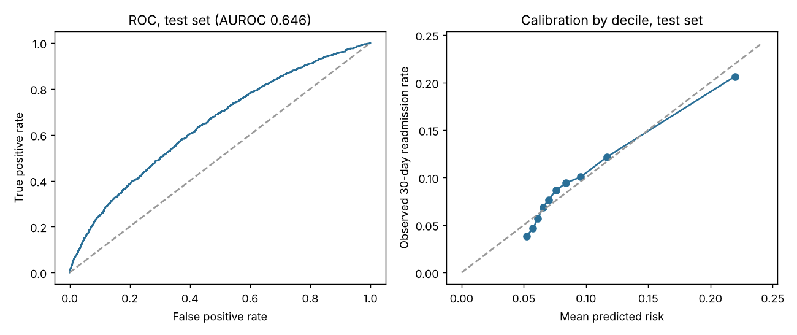

# SmartDischarge: 30-Day Readmission Risk at Discharge

Which diabetic patients should a care team call after discharge? This project scores each discharge for
30-day readmission risk, checks the score is calibrated and fair across groups, and shows what a team
with limited follow-up capacity would actually catch.

**Stack:** Python, pandas, scikit-learn, XGBoost, SHAP, FastAPI, pytest, GitHub Actions, Docker

## Data

[UCI Diabetes 130-US Hospitals, 1999-2008](https://archive.ics.uci.edu/dataset/296) (Strack et al., 2014):
101,766 real inpatient encounters of diabetic patients at 130 US hospitals. `data/download.sh` fetches it
and verifies the SHA-256.

**Cohort** (`src/smartdischarge/data.py`):

| Step | Rows |
|---|---|
| Raw encounters | 101,766 |
| First encounter per patient (later ones would leak the outcome across splits) | 71,518 |
| Exclude expired and hospice discharges (no readmission possible) | 69,973 |
| Readmitted within 30 days (positive label) | 6,277 (9.0%) |

Split 60/20/20, stratified: 41,983 train, 13,995 validation, 13,995 test. Each patient appears once.

## Results (`reports/metrics.json`)

Models were compared on the validation set only, then the chosen model was calibrated on validation and
scored once on the test set.

| Model | Validation AUROC | Test AUROC |
|---|---|---|
| Rule: rank by prior-year inpatient visits | 0.553 | 0.539 |
| Logistic regression | 0.648 | 0.639 |
| **XGBoost, Platt-calibrated (chosen)** | **0.654** | **0.646** (95% CI 0.630 to 0.661) |

- **Stability:** 5-fold cross-validation on train+validation, AUROC 0.654 ± 0.008.
- **Ranking quality:** AUPRC 0.162 vs a 0.090 random baseline.
- **Calibration:** Brier score 0.0798 vs 0.0816 for predicting the base rate. Observed readmission rates
  track predicted risk across all 10 deciles (top decile: 22.0% predicted, 20.6% observed).
- **In context:** [published work on this dataset](https://pmc.ncbi.nlm.nih.gov/articles/PMC12085305/) reports AUROC of about 0.63 to 0.67. This model sits in
  that range; 30-day readmission is hard to predict from discharge records alone.



### What a care team would catch (test set, 13,995 discharges, 1,255 readmissions)

| Follow-up capacity | Discharges called | Readmissions among them | Share of all readmissions | Lift vs random | Calls per readmission caught |
|---|---|---|---|---|---|
| Top 5% of scores | 700 | 163 | 13.0% | 2.6x | 4.3 |
| Top 10% | 1,400 | 289 | 23.0% | 2.3x | 4.8 |
| Top 20% | 2,799 | 459 | 36.6% | 1.8x | 6.1 |

How many of those readmissions a call would prevent depends on the intervention, which this data
doesn't measure, so no dollar savings are claimed.

### Fairness check: test AUROC by group (95% bootstrap CI)

| Group | n | Readmissions | AUROC |
|---|---|---|---|
| African American | 2,598 | 253 | 0.661 (0.620 to 0.698) |
| Caucasian | 10,373 | 940 | 0.637 (0.618 to 0.655) |
| Female | 7,465 | 675 | 0.650 (0.629 to 0.671) |
| Male | 6,529 | 580 | 0.641 (0.620 to 0.665) |
| Age under 50 | 2,256 | 157 | 0.654 (0.605 to 0.697) |
| Age 50 to 69 | 5,671 | 466 | 0.646 (0.620 to 0.673) |
| Age 70+ | 6,068 | 632 | 0.626 (0.603 to 0.648) |

All intervals overlap, so no group is ranked measurably worse than another. Asian, Hispanic, Other and
missing-race groups have fewer than 30 readmissions in the test set, so they are reported but not scored.

### What drives the score (mean |SHAP|, test sample of 2,000)

1. Discharge destination (home, home health, skilled nursing, transfer)
2. Primary diagnosis group
3. Prior-year inpatient visits
4. Payer code
5. Length of stay

## Serving and monitoring

- `src/smartdischarge/api.py`: FastAPI `POST /score` takes one encounter in the raw UCI column format
  and returns a calibrated probability and a tier. "Follow up" is the top 10% of validation-set scores
  (probability ≥ 0.135) and "monitor" the next 10% (≥ 0.105).
- `src/smartdischarge/drift.py`: Population Stability Index. Test vs validation score PSI is 0.001 (stable).
- 11 tests: cohort rules, ICD-9 grouping, feature vocabulary reuse, PSI behavior, the real-data cohort
  counts above, and an end-to-end API call.

## Run

```bash
pip install -e ".[test]"
bash data/download.sh
python -m smartdischarge.train      # writes reports/metrics.json, roc_calibration.png, model.joblib
pytest -q
uvicorn smartdischarge.api:app      # then POST /score
```

Results above are from a CPU run with seed 42; rerunning reproduces them exactly.

## Limitations

- Data is from 1999-2008 and only includes diabetic inpatients; a model for current use would need recent
  records and a check on the population it will score.
- AUROC of 0.646 is useful for prioritizing calls, not for decisions about individual patients.

## Changes from the earlier version

The earlier version reported a test AUROC of 0.537, imported modules that weren't in the repo, and showed
a $190K impact estimate not derived from the model. This rebuild is one runnable package; every number
above comes from `reports/metrics.json`.
